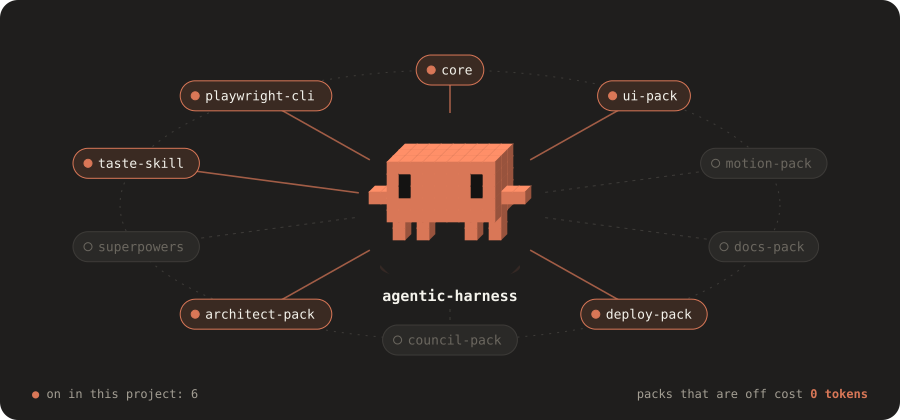

<div align="center">

<picture>
  <source media="(prefers-color-scheme: dark)" srcset="docs/assets/hero-dark.svg">
  <source media="(prefers-color-scheme: light)" srcset="docs/assets/hero-light.svg">
  
</picture>

<br>

### A plug-and-play catalogue for Claude Code. Describe your problem, get the right skills and agents, and pay nothing for the rest.

[](https://github.com/Parthkomalwad/agentic-harness/actions/workflows/validate.yml)
[](LICENSE)
[](https://code.claude.com/docs/en/plugins-reference)
[](#catalogue)
[](CONTRIBUTING.md)

[TL;DR](#tldr) ·
[Use it](#use-it-in-three-steps) ·
[Catalogue](#catalogue) ·
[claude.ai](#use-skills-in-claudeai-and-claude-desktop) ·
[Cloud](#use-it-in-cloud-sessions) ·
[How it works](#how-it-works) ·
[Contributing](CONTRIBUTING.md)

</div>

<br>

## TL;DR

- **What:** one Claude Code marketplace with 21 small packs: UI design, motion video, deployment, databases, testing, security, observability, shipping and launching, architecture, a multi-agent council, research, and cheap small-model helpers.
- **Why:** most setups install everything and fill the context window. Here every pack except `core` is **off**, and a pack that is off costs **zero tokens**.
- **How:** add the marketplace, install `core`, then tell Claude your problem. It picks the packs that fit and switches them on for that project only.

```text
/plugin marketplace add Parthkomalwad/agentic-harness
/plugin install core@agentic-harness
```

> **Off means zero.** No skills, no agents, no tokens from a pack you did not switch on. You choose per project, in one settings file.

## Use it in three steps

**1. Add the marketplace and the core pack** (once per machine):

```text
/plugin marketplace add Parthkomalwad/agentic-harness
/plugin install core@agentic-harness
```

**2. Say what you are working on.** The `packs` skill matches your problem to the catalogue:

```text
I need a landing page that does not look AI-generated, and then a cheap place to host it
```

```text
Pack           Why it fits                                   Adds
ui-pack        "build a landing page", tsx files in repo      style, components, screenshot audit
deploy-pack    "where should I deploy this"                   cost-ranked hosting plan
Enable both for this project? (y/n)
```

**See what is on.** `core` draws a band above the prompt with the harness packs that are on, context use and session cost. `/harness` prints the same line, even while Claude is working.

**3. Say yes.** It writes `.claude/settings.json` in that project. Run `/reload-plugins`, then ask for the work:

```text
/ui-pack:ui-build pricing page in the Linear style
/deploy-pack:deploy-strategy
```

Prefer to choose by hand? Copy a preset from [`templates/`](templates/) into `.claude/settings.json`:

| Preset | Packs |
|---|---|
| [`minimal.json`](templates/minimal.json) | `core` |
| [`ui.json`](templates/ui.json) | `core`, `ui-pack` (and its dependencies) |
| [`methodology.json`](templates/methodology.json) | `core`, `superpowers` |

## Catalogue

<!-- catalogue:start -->
<!-- Generated by scripts/build-docs.mjs from marketplace.json. Do not edit by hand. -->

### Foundation

| Pack | What it does | Try |
|---|---|---|
| `core` (**on**) | Always-on base: lean-code rules, the packs skill that finds and enables the right packs, and a band above the prompt showing active packs, context and cost. |  |
| `system-one` | Cheap small models for typed judgments (TypeSafe Jev) and extraction or summaries (ScaleDown), so the big model only decides. | `summarize this 40 page PDF cheaply before you read it` |
| `memory-pack` | Project memory as Markdown committed to the repo, so it follows you across machines and cloud sessions. A small index loads at session start. | `remember that we deploy from the release branch` |

### Build

| Pack | What it does | Try |
|---|---|---|
| `ui-pack` | UI without the AI look: DESIGN.md style, curated shadcn registries, build, screenshot, audit, fix. | `build a dashboard in the Vercel style` |
| `motion-pack` | Motion design in code: launch videos and reels rendered frame by frame, with a self-critique loop. | `make a 20s vertical launch video for <url>` |
| `docs-pack` | Create, restructure or update a README that explains the project clearly and looks good on GitHub. | `rewrite this README so people get it in 10 seconds` |
| `orchestrator` | Sweep a codebase with a dynamic workflow: cheap agents scan, stronger agents fix in isolated copies, a verifier keeps only proven changes. | `/orchestrator:sweep missing auth checks in src/routes` |
| `db-pack` | Schema design, safe zero-downtime migrations, and index review for Postgres, MySQL and SQLite. | `design the schema for a multi-tenant booking app` |

### Decide

| Pack | What it does | Try |
|---|---|---|
| `council-pack` | LLM council made of Claude agents: independent answers, anonymous peer ranking, chairman synthesis. | `/council-pack:council Postgres or DynamoDB for this?` |
| `architect-pack` | System and product design partner: requirements, options, Well-Architected pillar review, design artifacts. Also uploadable to claude.ai. | `design the architecture for a booking app` |
| `glassbox` | Open the black box: record why each decision was made, map how the code flows, and quiz yourself before accepting a change. | `explain what you just built and quiz me on it` |
| `research-pack` | Research across the web, GitHub, Reddit, X and YouTube with Agent Reach, cross-checked and cited. | `research what developers say about Bun vs Node in 2026` |

### Ship

| Pack | What it does | Try |
|---|---|---|
| `deploy-pack` | Deployment strategist: audits a project, recommends the cheapest fitting stack with cost estimates and an exit plan. | `where should I deploy this, cheaply?` |
| `test-pack` | Write the tests a change needs, find flaky tests, and loop on fixes until the suite is green. | `write tests for the change I just made` |
| `security-pack` | Secret and dependency checks, an OWASP review of a diff, and a guard that asks before dangerous shell commands run. | `security review my diff before I push` |
| `observability-pack` | Add structured logs, health checks, metrics and error tracking so production problems are visible and debuggable. | `add logging and error tracking to this API` |
| `ship-pack` | Branch, commit, open a PR and write release notes the way this repo wants, following its CLAUDE.md and CONTRIBUTING rules. | `commit this and open a PR` |
| `launch-pack` | Turn a finished project into a launch: README polish, a launch video, a blog post and social posts, all from the real code. | `help me launch this project` |

### Upstream

| Pack | Source | What it does |
|---|---|---|
| `superpowers` | [obra/superpowers](https://github.com/obra/superpowers) | brainstorm, plan, TDD, subagent execution and review methodology. |
| `taste-skill` | [Leonxlnx/taste-skill](https://github.com/Leonxlnx/taste-skill) | art direction for frontend work, image-to-code, redesign and style skills. |
| `playwright-cli` | [microsoft/playwright-cli](https://github.com/microsoft/playwright-cli) | token-efficient browser automation. Needs `npm i -g @playwright/cli`. |
| `web-design-guidelines` | [vercel-labs/agent-skills](https://github.com/vercel-labs/agent-skills) | Vercel's ~100-rule UI audit for accessibility, UX and performance. |
| `session-mem` | [thedotmack/claude-mem](https://github.com/thedotmack/claude-mem) | automatic session memory with compression and semantic search in a local database. Local only, so it does not reach cloud sessions. |
<!-- catalogue:end -->

## Use skills in claude.ai and Claude Desktop

Some skills help in plain chats too, not only in Claude Code. `architect` is the main one: brainstorm a product in a chat, and it walks through requirements, options and the pillar review, and draws diagrams and UI concepts as artifacts when they help.

1. Download the skill zip (for example `architect.zip`) from the [latest release](https://github.com/Parthkomalwad/agentic-harness/releases/latest).
2. In claude.ai, open **Settings**, find **Skills** under Capabilities (some accounts show it under Features), and upload the zip. Code execution must be on.
3. Start a chat: `Help me design the architecture for my product idea: ...`

Every skill in the repo is published as a zip on each release.

## Use it in cloud sessions

Cloud sessions ([claude.ai/code](https://claude.ai/code), `claude --cloud`, the mobile and Desktop apps) start from a fresh clone of your repo and **do not install plugins** that a repo lists in `.claude/settings.json`. Set the harness up once on the cloud environment instead, and every session that uses it gets the packs:

1. Open [claude.ai/code](https://claude.ai/code), edit your environment, and set network access to **Trusted** (or allow `github.com`).
2. Paste this as the **Setup script**, listing the packs you want:

```bash
git clone --depth 1 https://github.com/Parthkomalwad/agentic-harness /tmp/agentic-harness
HARNESS_PACKS="core memory-pack ui-pack deploy-pack" bash /tmp/agentic-harness/scripts/cloud-setup.sh
```

3. Start a session. New packs you add to this repo arrive automatically, because the script installs from the latest `main`.

Keys that packs need (such as `TYPESAFE_API_KEY`) go in the environment's **network secrets**, never in the setup script, which anyone using the environment can read.

`memory-pack` is built for this: its memory is Markdown committed under `.claude/memory/`, so it is in every clone, local or cloud.

## How it works

```text
agentic-harness/                       one repo is one marketplace
├── .claude-plugin/marketplace.json    the catalogue and its semantic index
├── plugins/<pack>/
│   ├── .claude-plugin/plugin.json
│   ├── skills/      know-how, loaded only when used
│   ├── agents/      roles that run in their own context
│   ├── workflows/   scripts that run many agents in phases
│   ├── hooks/       guards and automation
│   └── *.json       data the skills read (registries, providers)
├── templates/                         per-project presets
├── scripts/validate.mjs               catalogue rules, run in CI
└── .github/workflows/                 validation and skill-zip releases
```

Each catalogue entry carries the index the `packs` skill matches on:

| Field | What it holds |
|---|---|
| `metadata.intents` | Problems the pack solves, in a user's words |
| `relevance.signals` | Files, commands and dependencies that suggest the pack |
| `tags`, `category` | Grouping for search |

What each Claude Code piece costs while idle:

| Piece | Cost while idle | Use it for |
|---|---|---|
| Skill | its description only | Know-how, procedures, checklists |
| Agent | its description only | Roles: reviewer, council member |
| Workflow | none | Many agents in phases; only the final answer reaches your context |
| Hook or mod | none | Guards, panes, instant commands |
| MCP server | high, every session | Last resort, for systems with no CLI |

More in [docs/claude-code-primitives.md](docs/claude-code-primitives.md).

## Roadmap

| Item | Purpose |
|---|---|
| More upstream entries | Remotion and HyperFrames skills for motion-pack, Agent Reach as a plugin when it ships one |
| Pack evals in CI | Run the eval suites on every release once an API budget is set |

Have an idea? [Open a pack proposal](https://github.com/Parthkomalwad/agentic-harness/issues/new?template=pack-proposal.md).

## Contributing

New packs, skills and upstream entries are welcome. `main` only accepts pull requests, and every PR must pass CI. [CONTRIBUTING.md](CONTRIBUTING.md) is the step-by-step guide.

## Security

Hooks and mods run code on your machine with your permissions. Install packs only from sources you trust, and read any hook or mod first. `claude plugin validate <dir>` lists what a mod hooks into. Keys go in your system keychain through `userConfig`, never in a file.

## Credits

`motion-pack` adapts the method from the guide *How to Build a Motion Design Studio With Opus 5.5* (raycfu). `council-pack` follows the design of Andrej Karpathy's [LLM Council](https://github.com/karpathy/llm-council). `architect-pack` uses the six pillars of the [AWS Well-Architected Framework](https://aws.amazon.com/architecture/well-architected/).

## License

Community project, not affiliated with or endorsed by Anthropic. Claude and Claude Code are trademarks of Anthropic; the mascot in the hero is a fan-made tribute.


[MIT](LICENSE). Upstream packs keep their own licenses.
